<div align="center">


# Hue für HomeMatic

**Philips Hue in deiner HomeMatic-Zentrale. Schnell eingerichtet, in Echtzeit, ohne Umwege.**

[](https://github.com/amroeser/homematic-addon-hue/releases/latest)
[](https://github.com/amroeser/homematic-addon-hue/actions/workflows/release.yml)
[](LICENSE)


[**Herunterladen**](https://github.com/amroeser/homematic-addon-hue/releases/latest) &nbsp;·&nbsp; [Schnellstart](#schnellstart) &nbsp;·&nbsp; [Dokumentation](#dokumentation) &nbsp;·&nbsp; [Änderungen](CHANGELOG.md)

<br>

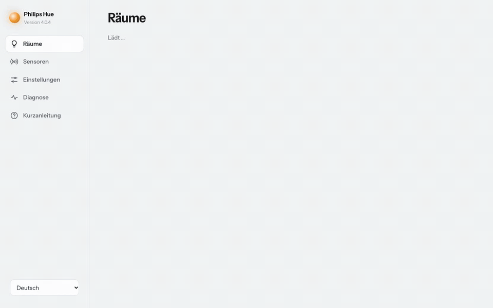

</div>

<br>

## Das Wichtigste

<table>
<tr>
<td width="33%" valign="top">

### Echtzeit

Schaltest du in der Hue-App oder am Hue-Schalter, weiß HomeMatic es sofort. Bewegungsmelder, Temperatur und Tasten landen ebenfalls ohne Verzögerung in Systemvariablen.

</td>
<td width="33%" valign="top">

### In einer Minute eingerichtet

Bridge auswählen, Knopf drücken, „Alle hinzufügen“. Jeder Raum und jede Zone bekommt ein CUxD-Gerät, das schalten, dimmen und färben kann. Eine Kurzanleitung erklärt beim ersten Start alles Wichtige.

</td>
<td width="33%" valign="top">

### Szenen ohne Befehle

Jeder Raum bekommt eine Auswahlliste mit seinen Szenen. In Programmen wählst du einfach „Entspannen“. Das Addon hält die Liste aktuell, du pflegst keine CUxD-Befehle. Deine bisherigen Geräte und Programme laufen unverändert weiter.

</td>
</tr>
<tr>
<td valign="top">

### Hue API v2

Die aktuelle Schnittstelle von Philips über HTTPS. Räume schalten mit einem einzigen Befehl, Farbverläufe, Effekte und Sonnenaufgang inklusive. Ältere Bridges laufen automatisch über API v1.

</td>
<td valign="top">

### Updates mit einem Klick

Neue Versionen installierst du direkt auf der Addon-Seite. Das Paket wird vorher per Prüfsumme kontrolliert.

</td>
<td valign="top">

### Läuft überall

CCU3 mit Original-Firmware, OpenCCU und RaspberryMatic. Ohne zusätzliche Pakete, getestet mit dem Tcl der jeweiligen Zentrale.

</td>
</tr>
<tr>
<td valign="top">

### Lampen ohne Hue

Deckenlampe am Shelly, Stehlampe an der HomeMatic-Steckdose: Ordne sie dem Raum zu, und sie schalten mit. Egal ob über die Addon-Seite, ein Programm, die Hue-App oder einen Hue-Schalter.

</td>
<td valign="top">

### Szenen-Tasten, die mitdenken

Eine Szenen-Taste steht nur auf „an“, solange ihre Szene aktiv ist. Programme mit „Umschalten“ wechseln so zuverlässig zwischen Hell und Gedimmt, statt versehentlich auszuschalten.

</td>
<td valign="top">

### Shelly im Blick

Schaltest du einen Shelly am Wandschalter, erfährt HomeMatic es trotzdem. Das Addon liest das Relais und korrigiert den CUxD-Schalter, ohne erneut zu schalten.

</td>
</tr>
</table>

<br>

## So sieht es aus

<table>
<tr>
<td width="58%">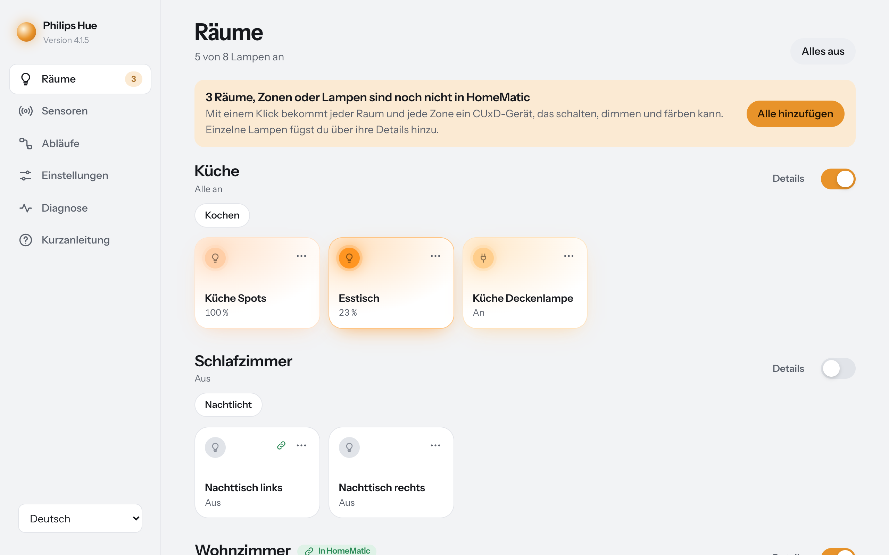</td>
<td valign="middle">

### Deine Räume auf einen Blick

Jede Lampe leuchtet in ihrer echten Farbe und Helligkeit, und das live. Antippen schaltet. Szenen rufst du direkt im Raum auf.

</td>
</tr>
<tr>
<td valign="middle">

### Alles zu einer Lampe an einem Ort

Helligkeit, Weißton, Farbe und Effekte. Darunter das passende HomeMatic-Gerät: verbunden, oder mit einem Klick angelegt.

</td>
<td width="58%">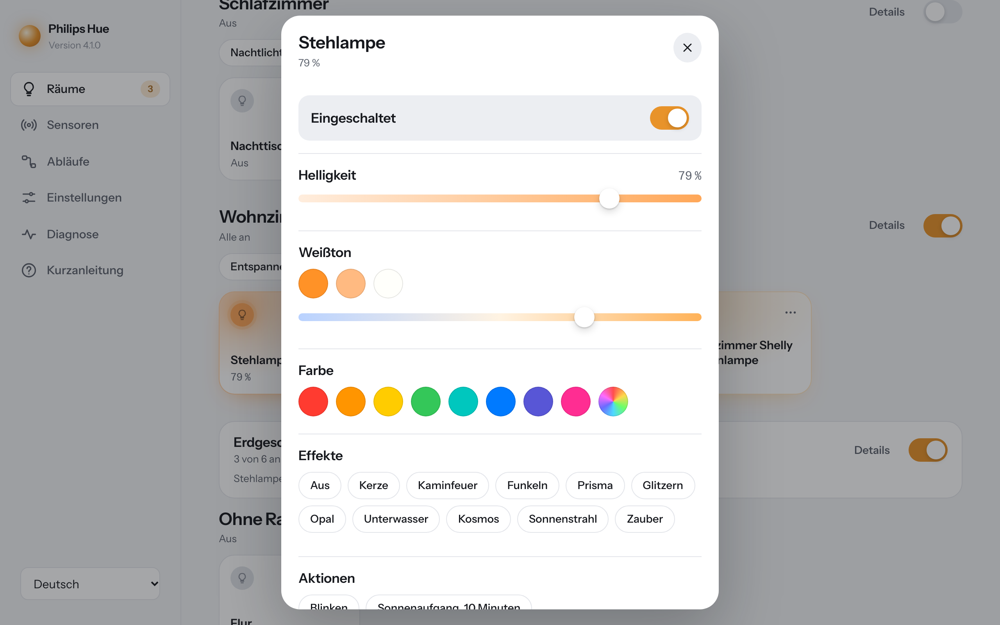</td>
</tr>
<tr>
<td width="58%">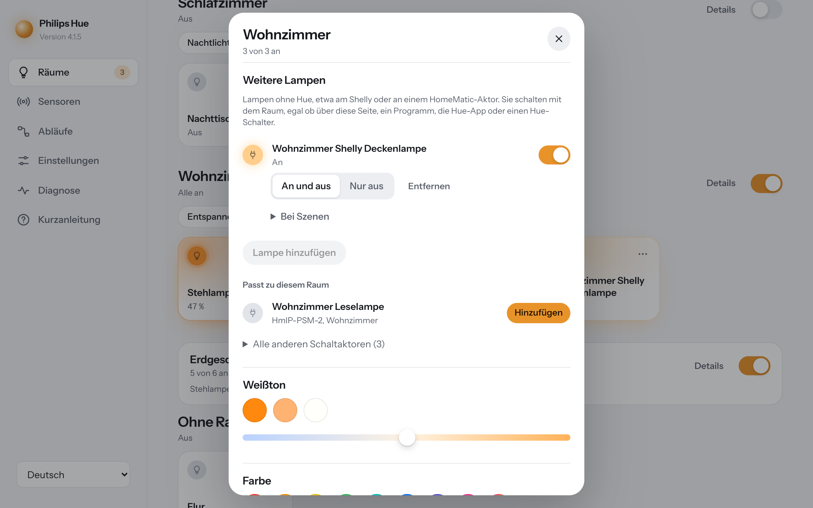</td>
<td valign="middle">

### Lampen ohne Hue gehören dazu

Shellys und HomeMatic-Aktoren erscheinen als Kacheln im Raum. Das Addon schlägt passende Geräte aus der CCU vor, je Szene legst du fest, ob sie an oder aus sein sollen.

</td>
</tr>
<tr>
<td valign="middle">

### Sofort sehen, ob alles läuft

Die Diagnose prüft Dienst, Bridge, Echtzeit-Verbindung und Version. Befehle probierst du direkt aus.

</td>
<td width="58%">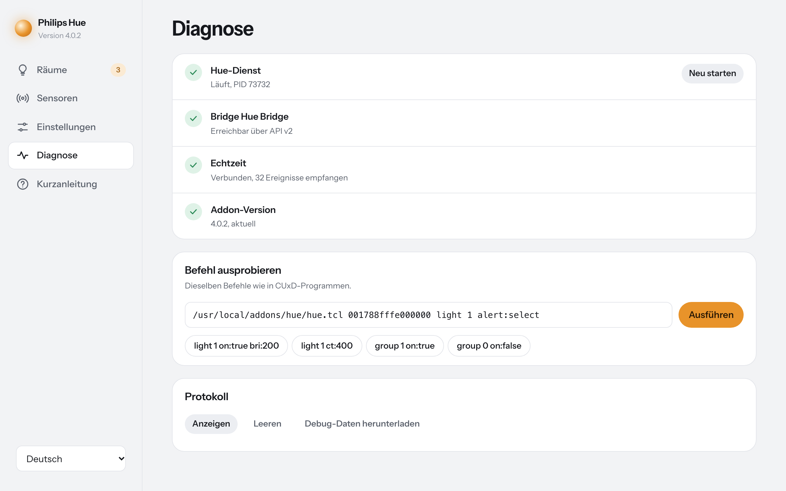</td>
</tr>
</table>

<table>
<tr>
<td width="58%">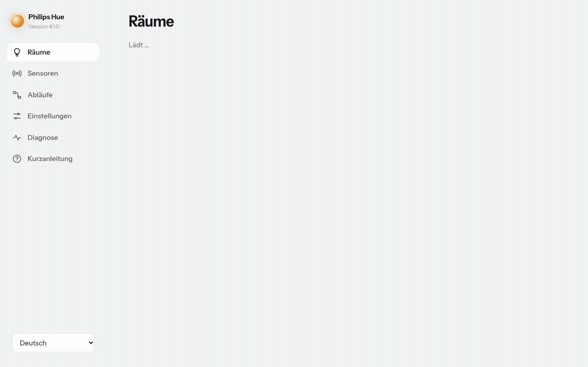</td>
<td valign="middle">

### Verstehen in zwei Minuten

Eine kurze, interaktive Anleitung zeigt beim ersten Start, wie Hue-App, Addon und HomeMatic zusammenspielen. Szenen-Auswahllisten schaltest du dort direkt ein.

</td>
</tr>
</table>

<div align="center">

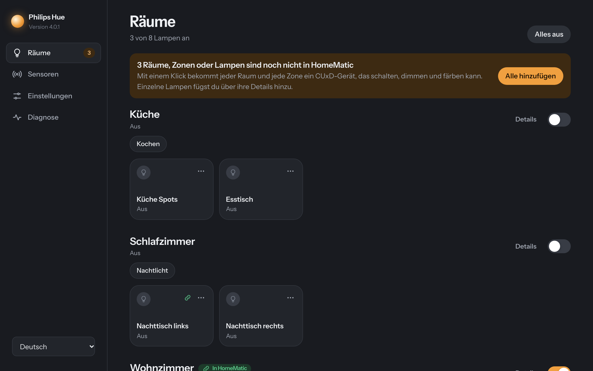
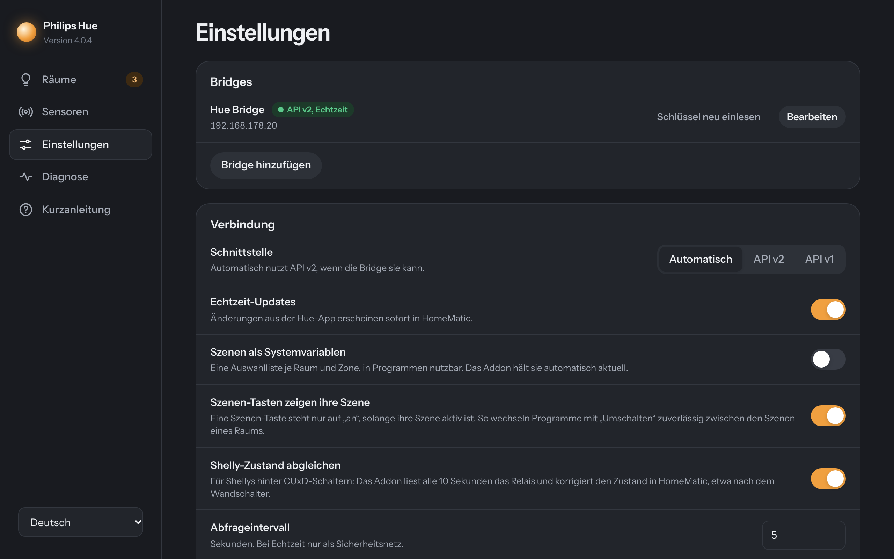

<sub>Hell und dunkel, je nach Einstellung deines Geräts.</sub>

<br><br>

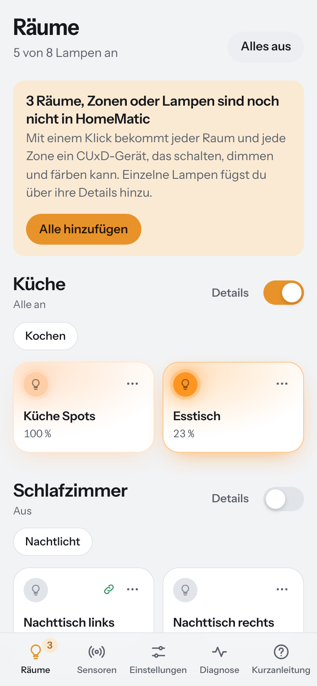
&nbsp;
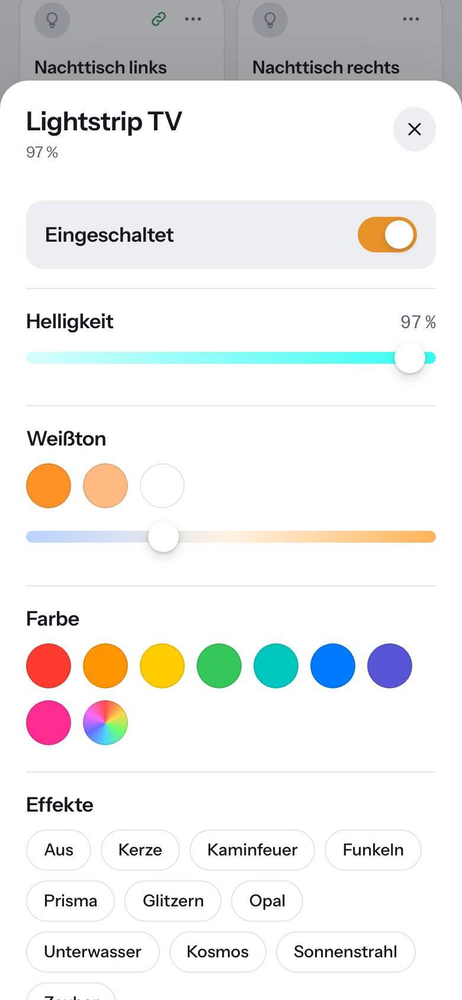
&nbsp;


<sub>Auch auf dem Handy bequem bedienbar.</sub>

</div>

<br>

## Schnellstart

<table>
<tr>
<td width="50%" valign="top">

**1. Installieren**

[`hm-hue.tar.gz`](https://github.com/amroeser/homematic-addon-hue/releases/latest) herunterladen (nicht entpacken) und in der CCU unter *Einstellungen → Systemsteuerung → Zusatzsoftware* installieren.

**2. Bridge verbinden**

Addon-Seite öffnen, Bridge auswählen, Knopf auf der Bridge drücken.

**3. Lampen übernehmen**

„Alle zu HomeMatic hinzufügen“ klicken und die neuen Geräte im Posteingang der CCU mit „Fertig“ bestätigen.

Kommst du vom alten Hue-Addon, installierst du einfach darüber. Alles Bestehende bleibt erhalten.

</td>
<td width="50%">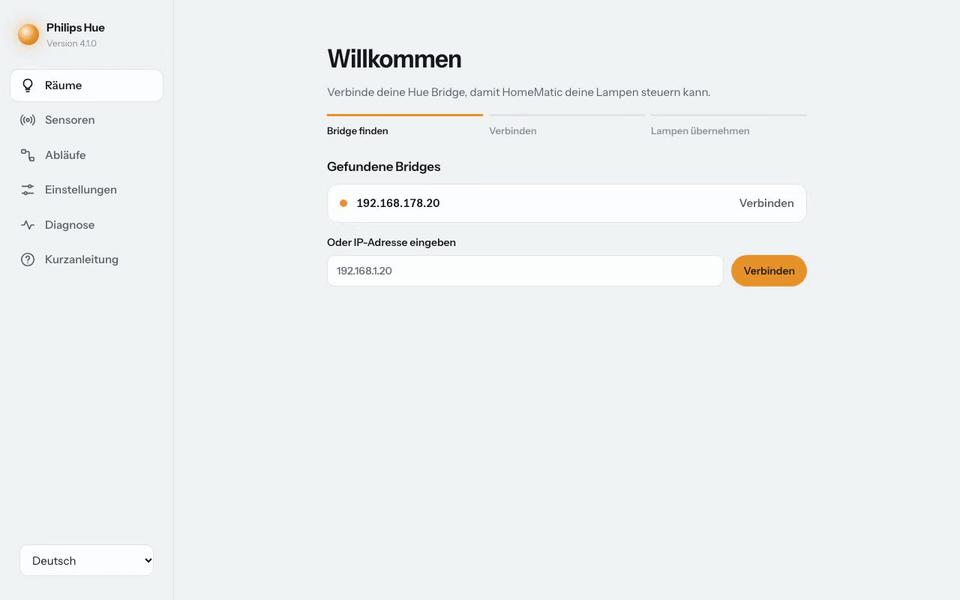</td>
</tr>
</table>

<br>

## Kompatibilität

| Zentrale | |
|---|---|
| CCU3, Original-Firmware | ✓ getestet (Tcl 8.2) |
| OpenCCU | ✓ getestet, im Alltag im Einsatz |
| RaspberryMatic | ✓ (Vorgänger von OpenCCU, gleiche Basis) |
| piVCCU, debmatic | ungetestet |

| Hue Bridge | Schnittstelle |
|---|---|
| Bridge v2 (eckig), aktuelle Firmware | API v2 mit Echtzeit, Szenen-Status, Lampen ohne Hue |
| Bridge v2 mit sehr alter Firmware | API v1, nach Firmware-Update in der Hue-App automatisch v2 |
| Bridge v1 (rund) | API v1 |

Die Schnittstelle hängt nur von der Bridge ab, nicht von der Zentrale. „Automatisch“ in den Einstellungen wählt sie selbst.

Voraussetzung: [CUxD](https://homematic-forum.de/forum/viewforum.php?f=37).

<br>

## Dokumentation

<details>
<summary><b>Lampen in Programmen und Skripten</b></summary>

<br>

Das Addon legt drei Arten von CUxD-Geräten an:

| Gerät | Kann | Gut für |
|---|---|---|
| **Farbe und Helligkeit** (`VIR-LG-RGBW-DIM`) | Schalten, Dimmen, Farbe, Weißton | Lampen und Räume, empfohlen |
| **Getrennte Kanäle** (Multi-DIM) | Kanal 2 Helligkeit, 3 Weißton, 4 Farbton, 5 Sättigung, Kanal 1 liest den Status neu | Programme, die einzelne Werte setzen |
| **Nur schalten** (`VIR-LG-ONOFF`) | An und aus | Steckdosen, einfache Lampen |

**Empfehlung:** Ein Gerät je Raum und je Zone, nicht je Lampe. Ein Raumbefehl schaltet alle Lampen gleichzeitig mit einem einzigen Funkbefehl. Einzelne Lampen nur dort, wo du sie einzeln brauchst. Was nur Licht betrifft (Hue-Schalter, Bewegungsmelder), regelt die Bridge selbst am schnellsten; HomeMatic übernimmt die Logik über Systemgrenzen hinweg.

**Szenen in Programmen:** Schalte unter *Einstellungen* „Szenen als Systemvariablen“ ein, oder direkt in der Kurzanleitung. Jeder Raum und jede Zone bekommt die Variable „Hue Szene <Raum>“ als Werteliste: Eintrag „Aus“ schaltet den Raum aus, die übrigen rufen die Szene auf. Wählst du in der Hue-App eine Szene, steht sie auch hier, sodass Programme darauf reagieren können. Das Addon hängt neue Szenen an und markiert gelöschte als „(entfernt)“, damit sich die Positionen in deinen Programmen nie verschieben. Namen werden in ASCII geschrieben (`Kueche`), weil die CCU intern ISO-8859-1 nutzt. Benötigt API v2.

**Weitere Lampen im Raum:** In den Details eines Raums ordnest du Lampen ohne Hue zu, etwa einen Shelly hinter einem CUxD-Schalter oder einen HomeMatic-IP-Aktor. Das Addon schlägt Geräte vor, deren CCU-Raum oder Name zum Hue-Raum passt. Sie schalten mit dem Raum an und aus, egal von wo der Raum geschaltet wurde, wahlweise auch nur aus. Je Szene legst du fest, ob die Lampe an, aus oder unverändert bleibt. Geschaltet wird über die CCU, deine Geräte und Programme bleiben, wie sie sind. Benötigt API v2.

**Bridge und Hue-Konto:** Die Diagnose zeigt, ob die Bridge mit dem Internet und einem Hue-Konto verbunden ist und von unterwegs erreichbar ist. Updates der Bridge und aller Geräte siehst du je Gerät, installierst sie mit einem Klick oder lässt sie automatisch zu einer festen Uhrzeit laufen. Darunter stehen alle Apps mit Zugriff und wann sie zuletzt benutzt wurden, praktisch bei einem Mieterwechsel. Das Hue-Konto selbst wechselt man in der Hue-App, eine kurze Anleitung steht in der Diagnose.

**Shelly-Zustand:** CUxD-Schalter, die einen Shelly per URL schalten (`/relay/0?turn=on` oder `/rpc/Switch.Set`), kennen den echten Zustand nicht. Das Addon liest alle 10 Sekunden das Relais und korrigiert den Schalter per `SET_STATE`, ohne den Befehl erneut auszuführen. Abschaltbar unter *Einstellungen*.

**Szenen als Tasten:** Für Fernbedienungen und Wandtaster legst du in den Details eines Raums je Szene eine CUxD-Taste an. Lang drücken ruft die Szene auf, kurz drücken schaltet den Raum aus. Die Taste speichert die Szenen-ID und ist damit unempfindlich gegen Umlaute und Umbenennen. Sie steht nur auf „an“, solange ihre Szene aktiv ist: Programme, die mit „Umschalten“ zwischen zwei Szenen eines Raums wechseln, schalten so nicht versehentlich aus.

In WebUI-Programmen verhalten sich die Geräte wie gewohnte HomeMatic-Geräte. Für Effekte oder Sonnenaufgang nutzt du ein CUxD-Exec-Gerät:

```
! Szene "Entspannen" im Wohnzimmer
dom.GetObject("CUxD.CUX2801001:1.CMD_EXEC").State("/usr/local/addons/hue/hue.tcl 0017881234abcd group 1 scene:Entspannen");

! Sonnenaufgang über 20 Minuten im Schlafzimmer
dom.GetObject("CUxD.CUX2801001:1.CMD_EXEC").State("/usr/local/addons/hue/hue.tcl 0017881234abcd light 6 timed_effect:sunrise transitiontime:12000");
```

Bridge-ID, Lampen-IDs und einen fertigen Befehl zum Kopieren findest du in der Detailansicht jeder Lampe unter *Technische Angaben*.

</details>

<details>
<summary><b>Befehlsreferenz</b></summary>

<br>

```
/usr/local/addons/hue/hue.tcl <bridge-id> <befehl> [parameter:wert] ...
```

| Befehl | |
|---|---|
| `light <id>` | Lampe steuern. ID aus API v1 oder v2 (UUID). |
| `group <id>` | Raum, Zone oder Gruppe steuern. `0` = alle Lampen. |
| `request <methode> <pfad> [json]` | Beliebige Anfrage an API v1, z. B. `request GET lights` |
| `request_v2 <methode> <pfad> [json]` | Beliebige Anfrage an API v2, z. B. `request_v2 GET resource/light` |

**Parameter**

| Parameter | Werte | |
|---|---|---|
| `on` | `true`, `false` | Ein- oder ausschalten |
| `bri` | `1`–`254` | Helligkeit, `0` schaltet aus |
| `bri_inc` | `-254`–`254` | Helligkeit relativ |
| `ct` | `153`–`500` Mirek | Weißton (153 ≈ 6500 K, 500 ≈ 2000 K), begrenzt auf die Lampe |
| `ct_inc` | `-347`–`347` | Weißton relativ |
| `hue`, `sat` | `0`–`65535`, `0`–`254` | Farbton, Sättigung |
| `hue_inc`, `sat_inc` | | relativ |
| `xy` | `0.3,0.4` | Farbe als CIE-Koordinaten |
| `rgb`, `rgb_bri` | `255,80,0` | Farbe als RGB, `rgb_bri` setzt auch die Helligkeit |
| `transitiontime` | Zehntelsekunden | Übergang, `10` = 1 s |
| `alert` | `select`, `lselect`, `none` | Blinken |
| `effect` | `none`, `colorloop`, `candle`, `fire`, `sparkle`, `prism`, `glisten`, `opal`, `underwater`, `cosmos`, `sunbeam`, `enchant` | `colorloop` über API v1, die übrigen über API v2 |
| `scene` | ID oder Name | Szene aufrufen. Die ID ist am robustesten. Namen werden tolerant gefunden: Groß- und Kleinschreibung, Leerzeichen (`_`) und Umlaute spielen keine Rolle. |
| `sleep` | Millisekunden | Vorher warten |
| `bri_mode` | `abs`, `inc` | `inc` erhält Helligkeitsunterschiede im Raum |
| `group_mode` | `group`, `lights` | `lights` schickt Raumbefehle einzeln an jede Lampe |

**Nur mit API v2**

| Parameter | Werte | |
|---|---|---|
| `gradient` | `ff0000,ff8800,0000ff` | Farbverlauf auf Gradient-Lampen, 2–5 Farben |
| `gradient_mode` | `interpolated_palette`, `interpolated_palette_mirrored`, `random_pixelated` | Art des Verlaufs |
| `timed_effect` | `sunrise`, `sunset`, `none` | Über `transitiontime`, Standard 30 min |
| `speed` | `0`–`1` | Tempo eines Effekts oder Übergangs |
| `signal` | `on_off`, `on_off_color`, `alternating`, `no_signal` | Signal geben, mit `signal_duration` (s) und `signal_color` |
| `identify` | `true` | Einmal blinken zur Identifikation |

Mehrere Farben trennst du mit Komma: In CUxD-Befehlen trennt ein `;` die Zeile.

**Beispiele**

```sh
hue.tcl 0017881234abcd light 1 on:true bri:200 ct:300 transitiontime:20
hue.tcl 0017881234abcd light 2 effect:candle speed:0.3
hue.tcl 0017881234abcd light 3 gradient:ff0000,ff8800,0000ff
hue.tcl 0017881234abcd group 1 scene:Entspannen
hue.tcl 0017881234abcd group 0 on:false
```

</details>

<details>
<summary><b>Wie v1-Befehle in API v2 übersetzt werden</b></summary>

<br>

| v1 | v2 |
|---|---|
| `on` | `on.on` |
| `bri`, `bri_inc` | `dimming.brightness` in %, `dimming_delta` |
| `ct`, `ct_inc` | `color_temperature.mirek`, `color_temperature_delta` |
| `xy`, `rgb`, `hue`, `sat` | `color.xy` im Farbraum der Lampe |
| `transitiontime` | `dynamics.duration` in ms |
| `alert:select` | `alert.action: breathe` |
| `effect` | `effects.effect`, mit `speed` als `effects_v2` |
| `scene` | `PUT resource/scene/<id>` mit `recall` |
| `light <n>` / `group <n>` | Ressource mit `id_v1` = `/lights/<n>` bzw. `grouped_light` von `/groups/<n>` |
| `group 0` | `grouped_light` von `bridge_home` |

</details>

<details>
<summary><b>Sensoren und Systemvariablen</b></summary>

<br>

Existiert eine Systemvariable mit passendem Namen, schreibt das Addon den Wert hinein. Fehlende Variablen legt die Seite *Sensoren* mit einem Klick an.

| Systemvariable | Typ | Inhalt |
|---|---|---|
| `Hue_reachable_<CUxD-Gerät>` | Logikwert | Lampe erreichbar |
| `Hue_motion_<bridge>_<id>` | Logikwert | Bewegung |
| `Hue_lux_<bridge>_<id>` | Zahl | Helligkeit in Lux |
| `Hue_temp_<bridge>_<id>` | Zahl | Temperatur in °C |
| `Hue_button_<bridge>_<id>` | Zeichenkette | Letztes Tastenereignis, z. B. `short_release` |
| `Hue Szene <Raum>` | Werteliste | Szene des Raums, siehe *Lampen in Programmen und Skripten* |

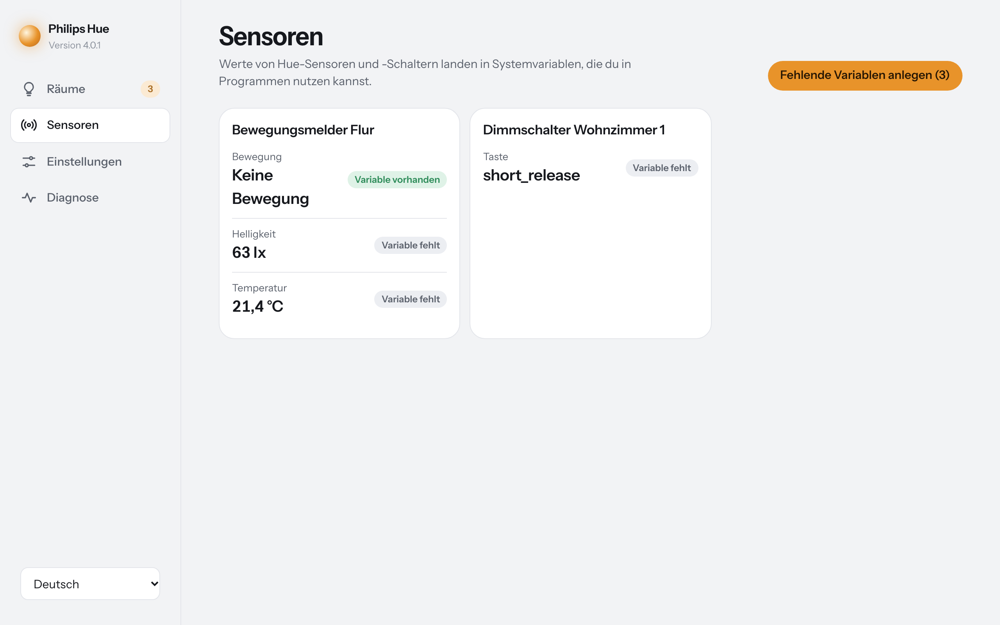

</details>

<details>
<summary><b>Einstellungen</b></summary>

<br>

| Einstellung | Standard | |
|---|---|---|
| Schnittstelle | Automatisch | API v2, wenn die Bridge sie kann, sonst v1 |
| Echtzeit-Updates | an | Event-Stream der API v2 |
| Szenen als Systemvariablen | aus | Je Raum und Zone eine automatisch gepflegte Szenen-Auswahlliste |
| Abfrageintervall | 5 s | Bei Echtzeit nur Sicherheitsnetz, mindestens 300 s |
| Bridge-Schlüssel prüfen | an | Speichert den Schlüssel der Bridge beim ersten Kontakt |
| Nicht erreichbare Lampen | Wie erreichbar | Oder als aus anzeigen, oder unverändert lassen |
| Beim Einschalten volle Helligkeit | aus | |
| Helligkeit im RGB-Wert | an | Der RGB-Wert eines Farbgeräts enthält die Helligkeit |
| Ausschalten ohne Übergang | Bei CUxD | Verhindert langsames Ausblenden |
| Erweitert | | Timeout, Drosselung für API v1, Protokoll |

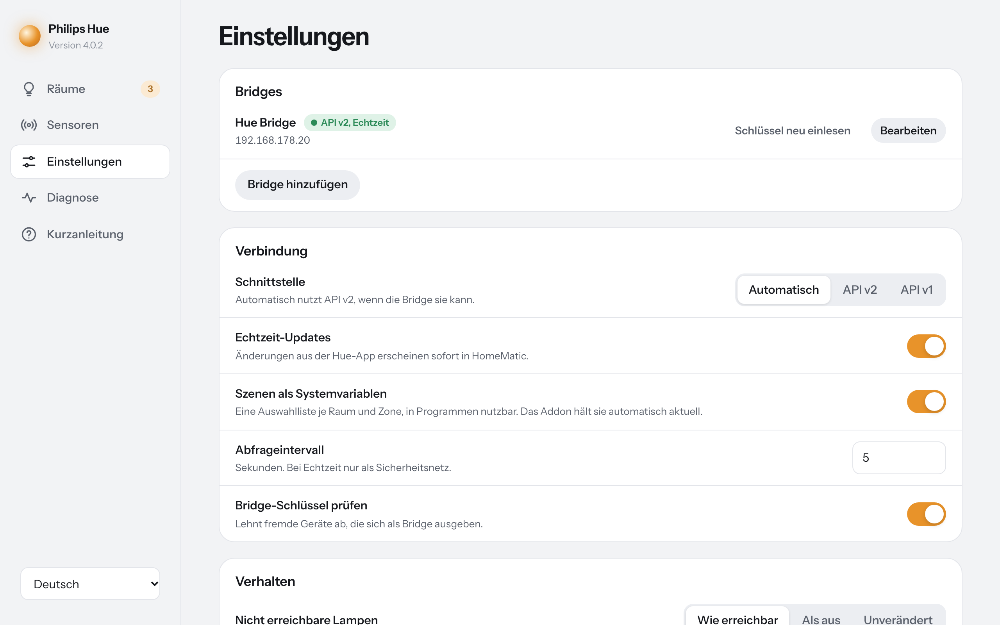

</details>

<details>
<summary><b>Updates</b></summary>

<br>

Die Addon-Seite meldet neue Versionen und installiert sie mit *Jetzt aktualisieren*. Das Paket kommt aus den GitHub-Releases. Vor der Installation prüft das Addon die SHA-256-Prüfsumme und bricht bei einer Abweichung ab. Deine Einstellungen bleiben erhalten, eine Sicherung liegt in `/usr/local/etc/config/hue.conf.bak`.

</details>

<details>
<summary><b>Fehlersuche</b></summary>

<br>

| Problem | Lösung |
|---|---|
| Bridge zeigt *API v1* | Firmware in der Hue-App aktualisieren. Die runde Bridge v1 kann nur API v1. |
| „TLS public key … changed“ | Bridge ersetzt oder zurückgesetzt: *Einstellungen → Schlüssel neu einlesen*. |
| „rejected the application key“ | Bridge entfernen und neu verbinden. CUxD-Geräte bleiben erhalten. |
| Zustand in HomeMatic veraltet | *Diagnose* prüfen. Ist die Echtzeit-Verbindung getrennt, Dienst neu starten. |
| Befehl tut nichts | Unter *Diagnose → Befehl ausprobieren* ausführen, die Ausgabe nennt den Grund. |

Protokolle: `/tmp/hue-addon-log.txt` (auch in der Diagnose), `/tmp/hue-install.log`, `/tmp/hue-update.log`. Die Debug-Daten enthalten deine App-Keys, entferne `username` und `clientkey`, bevor du sie teilst.

</details>

<details>
<summary><b>Entwicklung</b></summary>

<br>

```sh
python3 test/test_addon.py                    # Tests gegen eine simulierte Bridge (v1, v2, Event-Stream)
test/run_in_openccu.sh <openccu-oci-image>    # mit dem Tcl 8.6 von OpenCCU
test/run_in_ccu3.sh <eq-3/occu-checkout>      # mit dem Tcl 8.2 der CCU3-Firmware (emuliertes ARM)
python3 test/dev_server.py --demo             # Oberfläche lokal mit einer Beispielwohnung
python3 tools/make_media.py                   # Screenshots und Videos neu erzeugen
./pack_addon.sh                               # Paket nach dist/ bauen
```

| Datei | Aufgabe |
|---|---|
| `addon/hue.tcl` | Befehlszeile, von CUxD aufgerufen |
| `addon/hued.tcl` | Hue-Dienst: Befehle, Event-Stream, Abgleich mit CUxD und Systemvariablen |
| `addon/lib/hue_v2.tcl` | API v2: Cache, ID-Zuordnung, Übersetzung |
| `addon/lib/json.tcl` | JSON-Parser für Tcl 8.2 bis 8.6 |
| `addon/www/index.html` | Addon-Seite |

Ein Release entsteht durch einen Tag `v<VERSION>`. GitHub Actions testet, baut und veröffentlicht das Paket mit Prüfsumme.

</details>

## Credits

**Jan Schneider** hat das Addon 2017 geschrieben und bis Version 3.2.5 entwickelt: Hue API v1, CUxD-Geräte und den Hue-Dienst, auf denen alles aufbaut. **Alexander Maximilian Röser** hat es zu Version 4 weiterentwickelt: Hue API v2 mit Echtzeit, neue Oberfläche, CCU3-Unterstützung, Szenen, Lampen ohne Hue und Updates mit einem Klick.

Im Paket stecken außerdem tcllib inifile (Tcl/Tk-Lizenz) und die Schrift Instrument Sans (SIL Open Font License). Alle Komponenten, Lizenzen und Werkzeuge stehen in [CREDITS.md](CREDITS.md). Jedes Release enthält eine Software-Stückliste (SBOM) im Format CycloneDX: `hm-hue.cdx.json`.

<br>

<div align="center">
<sub>
Ursprünglich von Jan Schneider (Versionen 1 bis 3), weiterentwickelt von Alexander Maximilian Röser (Version 4). GPL-3.0. <a href="CREDITS.md">Credits, Lizenzen und SBOM</a><br>
Philips Hue ist eine Marke von Signify. Dieses Projekt steht in keiner Verbindung zu Signify oder eQ-3.
</sub>
</div>
