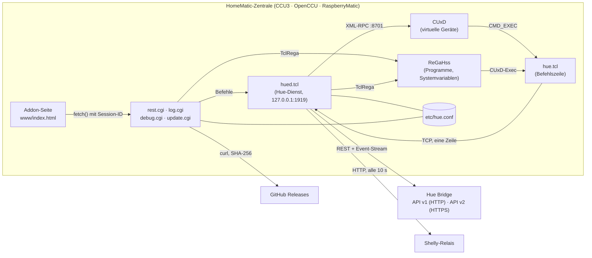
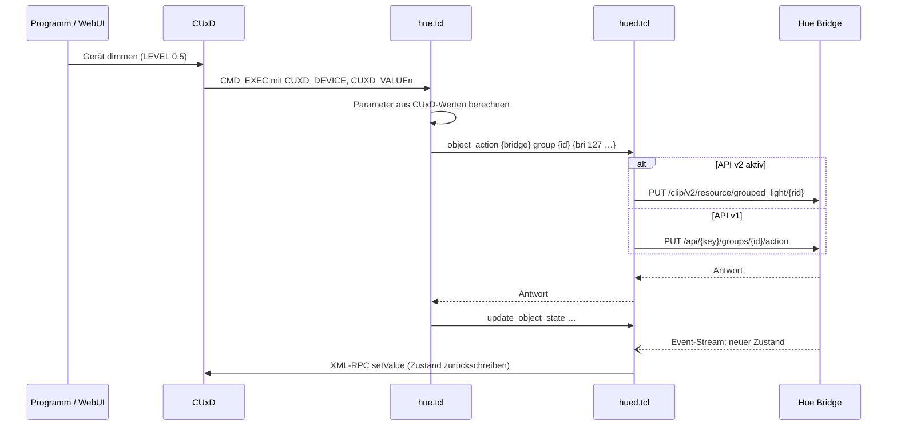
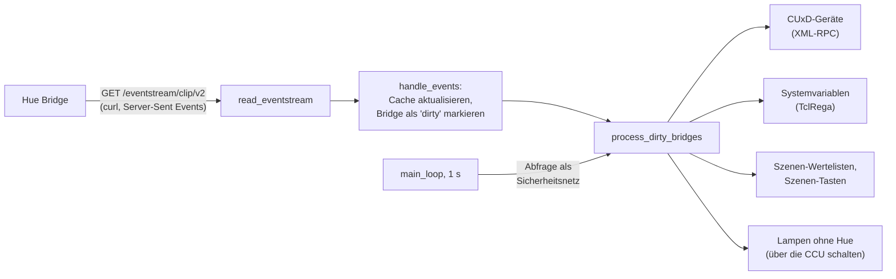
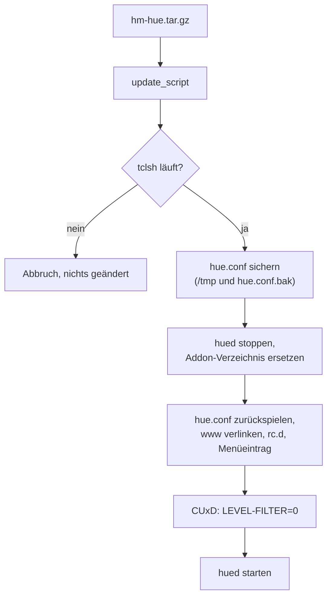
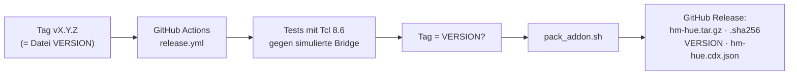

# Architektur

Dieses Dokument beschreibt, wie das Addon „Hue für HomeMatic“ aufgebaut ist: welche Teile es gibt, wie sie miteinander sprechen und warum sie so gebaut sind. Es richtet sich an alle, die am Code mitarbeiten oder ein Problem tiefer verstehen wollen. Bedienung und Befehlsreferenz stehen im [README](../README.md), Sicherheitsfragen in [SECURITY.md](../SECURITY.md).

## Überblick



Das Addon besteht aus drei Prozessarten:

| Teil | Lebensdauer | Aufgabe |
|---|---|---|
| `hued.tcl` | dauerhaft, ein Prozess | Spricht mit den Bridges, hält den Zustand im Speicher, empfängt den Event-Stream und gleicht CUxD-Geräte und Systemvariablen ab. |
| `hue.tcl` | je Befehl ein kurzer Prozess | Wird von CUxD oder einem Programm aufgerufen, übersetzt die Parameter und gibt sie an `hued` weiter. |
| `www/*.cgi` | je HTTP-Anfrage ein Prozess | Backend der Addon-Seite, läuft im Webserver der CCU. |

Alles ist in Tcl geschrieben und läuft ohne zusätzliche Pakete auf Tcl 8.2 (CCU3-Firmware) bis 8.6 (OpenCCU). Daraus folgen einige Regeln für den Code: kein `dict`, kein `{*}`, kein `lassign`, keine Operatoren `eq`/`in`, kein `2>@1`. JSON liest und schreibt `lib/json.tcl`, weil tcllib auf der CCU fehlt.

## Verzeichnisse

| Pfad | Inhalt |
|---|---|
| `addon/hue.tcl` | Befehlszeile, von CUxD und Programmen aufgerufen |
| `addon/hued.tcl` | Hue-Dienst |
| `addon/lib/hue.tcl` | Gemeinsamer Kern: Konfiguration, Protokoll, Sperren, API v1, CUxD, Systemvariablen, Debug-Daten |
| `addon/lib/hue_v2.tcl` | API v2: Transport mit TLS, Ressourcen-Cache, ID-Zuordnung v1↔v2, Übersetzung der Befehle |
| `addon/lib/json.tcl` | JSON-Parser und -Erzeuger für Tcl 8.2 bis 8.6 |
| `addon/lib/ini.tcl` | INI-Datei lesen und schreiben (aus tcllib inifile) |
| `addon/lib/extras.tcl` | Lampen ohne Hue in Räumen und Szenen |
| `addon/lib/flows.tcl` | Abläufe: CCU-Programme lesen, anlegen, ändern, sichern |
| `addon/lib/system.tcl` | Bridge-Status, Hue-Konto, Firmware-Updates, Apps mit Zugriff |
| `addon/lib/update.tcl` | Update-Prüfung und Ein-Klick-Update |
| `addon/www/index.html` | Addon-Seite, eine Datei ohne Build-Schritt |
| `addon/www/rest.cgi` | JSON-API der Addon-Seite |
| `addon/www/log.cgi`, `debug.cgi` | Protokoll und Debug-Daten, nur mit gültiger Session |
| `addon/www/update.cgi` | Versionsabfrage für *Einstellungen → Zusatzsoftware* der CCU |
| `addon/etc/hue.conf` | Einstellungen und Bridges (wird bei Updates übernommen) |
| `hue` | rc.d-Skript: Start, Stopp, Deinstallation |
| `update_script` | Installation und Update auf der CCU |
| `debian/` | Paket für debmatic |
| `test/` | Simulierte Bridge, Tests, Entwicklungsserver |
| `tools/` | SBOM und Medien für das README |

## Laufzeitverhalten

### Ein Befehl von HomeMatic zur Lampe



`hue.tcl` liest die CUxD-Umgebungsvariablen (`CUXD_DEVICE`, `CUXD_TRIGGER_CH`, `CUXD_VALUE<n>`), baut daraus v1-Parameter (`on`, `bri`, `ct`, `xy` …) und schickt eine Zeile über TCP an `hued`. Der Dienst entscheidet je Bridge, ob er die API v1 oder v2 benutzt. Die Parameter bleiben dabei immer im v1-Modell; `hue_v2.tcl` übersetzt sie (Tabelle im README unter *Wie v1-Befehle in API v2 übersetzt werden*).

Ausnahme sind `request` und `request_v2`: Sie umgehen `hued` und sprechen direkt mit der Bridge.

Das Weiterreichen an `hued` hat zwei Gründe: Der Dienst hält eine warme Verbindung und den Ressourcen-Cache, und er drosselt Raumbefehle an API v1, damit die Bridge nicht überlastet.

### Protokoll zwischen `hue.tcl` und `hued`

`hued` lauscht auf `127.0.0.1:1919` (`hued_address`, `hued_port` in `lib/hue.tcl`). Jede Verbindung trägt genau eine Zeile Text und erhält eine Antwort, danach wird sie geschlossen.

| Befehl | Wirkung |
|---|---|
| `object_action <bridge> <light\|group> <id> <params>` | Lampe oder Gruppe schalten |
| `object_state <bridge> <typ> <id>` | Zustand aus dem Cache |
| `update_object_state <bridge> <typ> <id> [sek]` | Zustand neu abgleichen, sofort oder verzögert |
| `objects <bridge>` | Übersicht für die Addon-Seite |
| `reload`, `reload_extras` | Konfiguration neu lesen |
| `status` | Zustand des Dienstes für die Diagnose |

### Zustand von der Bridge nach HomeMatic



- **API v2:** Je Bridge läuft ein `curl`-Prozess am Event-Stream. Ereignisse ändern den Cache in `hue_v2.tcl` (`R(<bridge>|<rid>|<pfad>)`), betroffene Bridges werden gesammelt abgeglichen. Bei bestehender Verbindung fragt `hued` höchstens alle 300 s ab, alle 900 s lädt er den Cache vollständig neu.
- **API v1:** `hued` fragt im eingestellten Intervall (Standard 5 s) ab.
- **Abgleich:** Ändert sich ein Zustand, schreibt `hued` ihn per XML-RPC in das CUxD-Gerät und per TclRega in die passenden Systemvariablen (`Hue_reachable_*`, `Hue_motion_*`, `Hue_lux_*` …). Ein Befehl wird dabei nicht erneut ausgelöst.
- **Ausfall:** Bricht der Stream ab, versucht `hued` es mit wachsendem Abstand erneut und fragt bis dahin regelmäßig ab.

### Zuordnung von IDs

Die CUxD-Geräte speichern Bridge-ID, Objekttyp und eine ID im Befehl. Alte Geräte nutzen v1-Nummern (`light 3`, `group 1`), neue können v2-UUIDs nutzen. `hue_v2.tcl` hält Indizes in beide Richtungen (`id_v1` ↔ `rid`, Raum ↔ `grouped_light`, `group 0` ↔ `bridge_home`). Bestehende Geräte und Programme laufen deshalb nach dem Wechsel auf API v2 unverändert weiter.

### Szenen

- **Wertelisten:** Mit „Szenen als Systemvariablen“ legt `hued` je Raum und Zone die Variable `Hue Szene <Raum>` an. Neue Szenen werden angehängt, gelöschte als „(entfernt)“ markiert. So verschieben sich die Positionen in Programmen nie. Namen werden in ASCII geschrieben, weil ReGaHss ISO-8859-1 nutzt.
- **Szenen-Tasten:** CUxD-Schalter mit gespeicherter Szenen-ID. `process_scene_switches` setzt sie nur auf „an“, solange die Szene aktiv ist.

### Lampen ohne Hue und Shelly-Abgleich

`lib/extras.tcl` speichert je Raum und Szene, welche CCU-Kanäle mitschalten sollen (Abschnitt `[extras]` in `hue.conf`). Schaltet der Raum, egal von wo, schaltet `hued` diese Kanäle über ReGaHss. CUxD-Schalter, die einen Shelly per URL steuern, liest `hued` alle 10 s per HTTP aus und korrigiert den CUxD-Zustand mit `SET_STATE`, ohne den Befehl erneut auszuführen.

### Abläufe

`lib/flows.tcl` liest alle CCU-Programme mit einem ReGa-Skript und stellt sie als Graph aus Taste, Programm und Ziel dar. Anlegen, Ändern und Löschen erzeugt ReGa-Skripte aus geprüften Bausteinen (`check_name`, `check_value`). Vor jeder Änderung sichert das Addon das Programm nach `/usr/local/etc/config/hue-flow-backups` (die letzten 40). Das Programm in der CCU bleibt die einzige Quelle; Programme mit Bedingungen, „Sonst“ oder Skripten werden nur angezeigt.

## Addon-Seite

`www/index.html` ist eine einzelne Datei mit HTML, CSS und JavaScript, ohne Framework und ohne Build-Schritt. Sie spricht ausschließlich mit `rest.cgi`:

```
rest.cgi?sid=@<session>@&path=<pfad>    (GET, POST, PUT, DELETE; Body als JSON)
```

Wichtige Pfade:

| Pfad | |
|---|---|
| `login` | Anmeldung an der CCU, liefert eine Session-ID (einziger Pfad ohne Session) |
| `config`, `config/global`, `config/bridge/<id>` | Einstellungen lesen und schreiben |
| `discover-bridges`, `establish-link` | Bridge finden und verbinden |
| `bridges/<id>/info\|objects\|system\|swupdate\|repin\|request` | Bridge-Daten, Status, Firmware, TLS-Schlüssel neu einlesen, Anfragen aus der Diagnose |
| `create-cuxd-device`, `get-cuxd-device-map`, `create-sysvars` | CUxD-Geräte und Systemvariablen anlegen |
| `flows/…` | Abläufe |
| `extras/…` | Lampen ohne Hue |
| `test-command` | `hue.tcl` mit Argumenten ausführen (Diagnose) |
| `hued/status\|restart` | Dienst |
| `update/check\|install` | Ein-Klick-Update |

Jede Anfrage außer `login` prüft die Session gegen die CCU, siehe [SECURITY.md](../SECURITY.md#authentifizierung-der-addon-seite).

## Konfiguration

`etc/hue.conf` ist eine INI-Datei:

```ini
[global]
api_version=auto          ; auto | v1 | v2
eventstream=1
https_verify=fingerprint  ; none | fingerprint | strict
poll_state_interval=5
log_level=4

[extras]
; Lampen ohne Hue je Raum und Szene

[bridge_001788fffe000000]
name=Wohnung
ip=192.168.1.20
port=80
https_port=443
username=<App-Key der Bridge>
clientkey=<Client-Key, nur API v2>
tls_pubkey_sha256=<SHA-256 des öffentlichen Schlüssels>
```

Zugriffe auf Datei und Protokoll werden über Sperren synchronisiert. Eine Sperre ist ein lokaler Server-Socket ab Port 11200: Wer den Port belegen kann, hält die Sperre. Das funktioniert auf allen Tcl-Versionen ohne zusätzliche Pakete.

## Installation und Update



- **Manuell:** über *Einstellungen → Systemsteuerung → Zusatzsoftware*. Die CCU entpackt das Paket und ruft `update_script` auf.
- **Ein-Klick-Update:** `lib/update.tcl` lädt `VERSION`, `hm-hue.tar.gz` und `hm-hue.tar.gz.sha256` aus dem neuesten GitHub-Release, vergleicht die Prüfsumme, entpackt nach `/usr/local/tmp/hue-update` und startet `update_script` losgelöst im Hintergrund, weil es die Dateien des laufenden Prozesses ersetzt.
- **debmatic:** `./pack_addon.sh --deb` baut ein Debian-Paket mit systemd-Unit (`debian/`).

Pfade auf der CCU:

| Pfad | |
|---|---|
| `/usr/local/addons/hue/` | Addon |
| `/usr/local/etc/config/addons/www/hue` | Link auf `www/`, erreichbar unter `/addons/hue/` |
| `/usr/local/etc/config/rc.d/hue` | Start und Stopp |
| `/usr/local/etc/config/hue.conf.bak` | Sicherung der Einstellungen |
| `/usr/local/etc/config/hue-flow-backups/` | Sicherungen geänderter Programme |
| `/tmp/hue-addon-log.txt`, `/tmp/hue-install.log`, `/tmp/hue-update.log` | Protokolle |

## Build, Tests und Release



- `test/mock_bridge.py` simuliert eine Bridge mit API v1, API v2 über HTTPS und Event-Stream. `test/test_addon.py` startet `hued` dagegen und prüft Befehle, Abgleich, Oberfläche und Update.
- `test/run_in_openccu.sh` und `test/run_in_ccu3.sh` führen dieselben Tests mit dem Tcl der echten Firmware aus (Tcl 8.2 per emuliertem ARM).
- `pack_addon.sh` baut ein Archiv mit festem Besitzer und sortierten Einträgen (nicht bitgleich reproduzierbar, Zeitstempel stammen aus dem Checkout), die Prüfsumme und eine CycloneDX-SBOM (`tools/make_sbom.py`), die auch die Addon-Seite ausliefert.
- Ein Release entsteht nur durch einen Tag, der zur Datei `VERSION` passt. Die Release-Notizen kommen aus `CHANGELOG.md`.
- Der Release-Job signiert für Paket und SBOM eine Build-Provenance (`actions/attest-build-provenance`). Alle übrigen Jobs laufen nur mit Leserechten, Actions sind per SHA gepinnt und werden von Dependabot aktuell gehalten.

## Entwurfsentscheidungen

| Entscheidung | Begründung |
|---|---|
| Tcl ohne Zusatzpakete | Läuft auf jeder Zentrale, auch der CCU3 mit Tcl 8.2, ohne etwas nachzuinstallieren. |
| Ein Dienst statt direkter Bridge-Aufrufe | Warmer Cache, Event-Stream, Drosselung und schnelle Antworten für CUxD. |
| Befehle bleiben im v1-Modell | Bestehende CUxD-Geräte und Programme laufen nach dem Wechsel auf API v2 weiter. |
| `curl` und `openssl` als Prozesse | Tcl 8.2 hat kein TLS; beide sind auf allen Zentralen vorhanden (notfalls das `curl` von CUxD). |
| Schlüssel-Pinning statt CA | Die Bridge hat ein selbst signiertes Zertifikat; Pinning beim ersten Kontakt schützt vor späterem Austausch. |
| CCU-Programm als einzige Quelle für Abläufe | Keine zweite Kopie, die auseinanderlaufen kann; Änderungen in der CCU bleiben gültig. |
| Wertelisten wachsen nur | Positionen in Programmen bleiben stabil, auch wenn Szenen gelöscht werden. |
